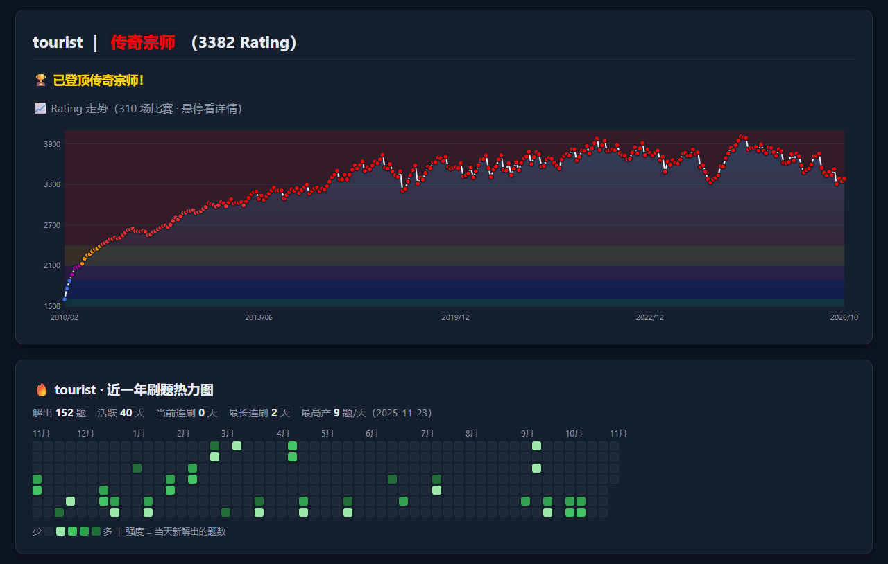
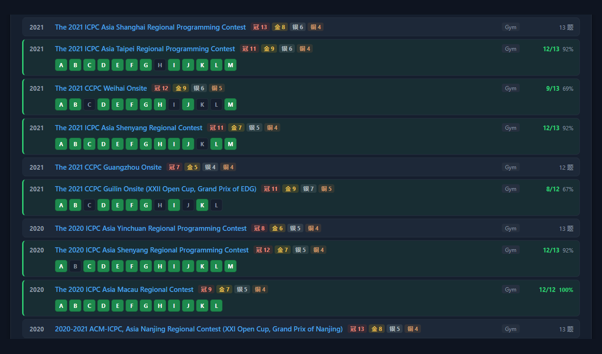
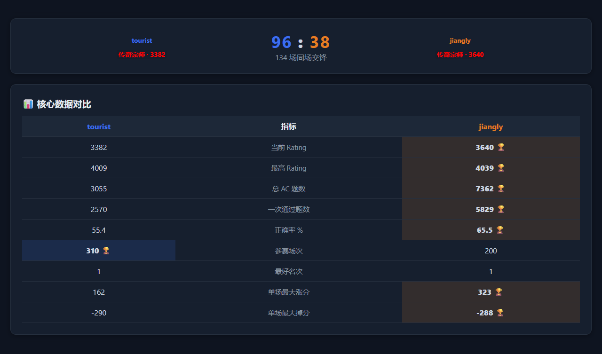
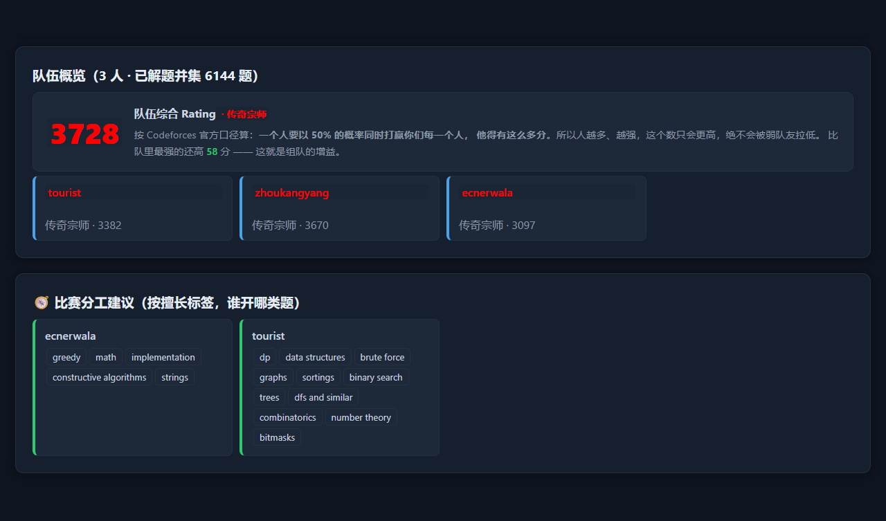
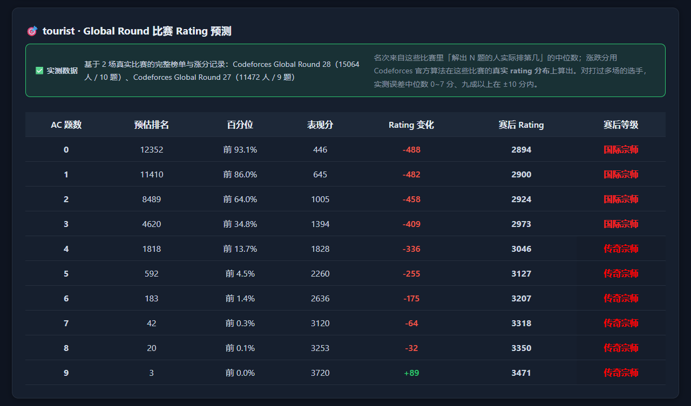

# ⚔️ CF 团队助手 v2.22

本地运行的 Codeforces 训练助手，适合个人刷题和 ICPC 组队训练：看 Rating、预测涨跌分、找短板、按条件出题、安排队伍分工。
Windows 下载即用，关掉网页自动退出；只调用 Codeforces 官方 API，数据都存在本机。



## ✨ 功能

- **🏠 首页**：Rating 走势、按 CF 官方算法预测涨跌分、弱点墙、训练计划与题目推荐、刷题热力图、未来 30 天比赛日历、关注队友
- **🎲 刷题器**：按难度和标签（可包含 / 排除）出题，可排除做过的题，附洛谷中文题面
- **🏆 ICPC 比赛库**：CF 上历年 ICPC / CCPC 比赛分四档，标出全队做过哪些题、几题能拿金 / 银 / 铜，还能随机抽一场来练
- **🤝 组队作战**：队伍综合 Rating、技能矩阵、分工建议、共同弱项、合练题单
- **🆚 对比**：两人交锋记录、Rating 走势同图、各项数据对比
- **📈 复盘**：刷题难度的变化轨迹，以及打过的比赛里还没补的题
- **⭐ 题单**：收藏待做的题，跨会话保留

<table>
  <tr>
    <td width="50%"><a href="docs/screenshots/icpc.png"></a><br><sub>🏆 区域赛奖牌线，以及 jiangly 每道题的完成情况</sub></td>
    <td width="50%"><a href="docs/screenshots/vs.png"></a><br><sub>🆚 tourist vs jiangly：134 场同场交锋</sub></td>
  </tr>
  <tr>
    <td><a href="docs/screenshots/team.png"></a><br><sub>🤝 tourist + zhoukangyang + ecnerwala：队伍综合 Rating 与分工</sub></td>
    <td><a href="docs/screenshots/predict.png"></a><br><sub>🎯 tourist 打 Global Round：要做出 9 题、排进前 3 才能涨分</sub></td>
  </tr>
</table>

## 📥 下载即用

到 [Releases](https://github.com/morning-cml/cf-team-helper/releases/latest) 下载 `cf-team-helper-v*-win64.zip`，解压后双击 `cf辅助工具.exe`，浏览器会自动打开。
不需要装 Python，但电脑要能访问 codeforces.com。

详细用法和常见问题见 **[使用说明](使用说明.md)**。

## 🛠️ 从源码运行

```bash
python -m pip install -r requirements.txt
python run.py                   # 自动打开 http://127.0.0.1:5000
python tests/smoke_test.py      # 冒烟测试，离线即可跑
```

打包 exe 运行 `build.bat`，需要 python.org 版的 Python（msys2 / MinGW 版打出来的 exe 换台机器就跑不起来）。
每个版本改了什么见 [CHANGELOG](CHANGELOG.md)；问题和建议欢迎提 [Issue](https://github.com/morning-cml/cf-team-helper/issues)。

## 📜 许可证

[GPL-3.0](LICENSE) © 2026 [morning-cml](https://github.com/morning-cml)。可以自由使用、修改和分发；分发修改版时必须同样以 GPL-3.0 开源，并保留原作者署名、注明改动。

觉得好用的话，欢迎点个 ⭐ Star。
